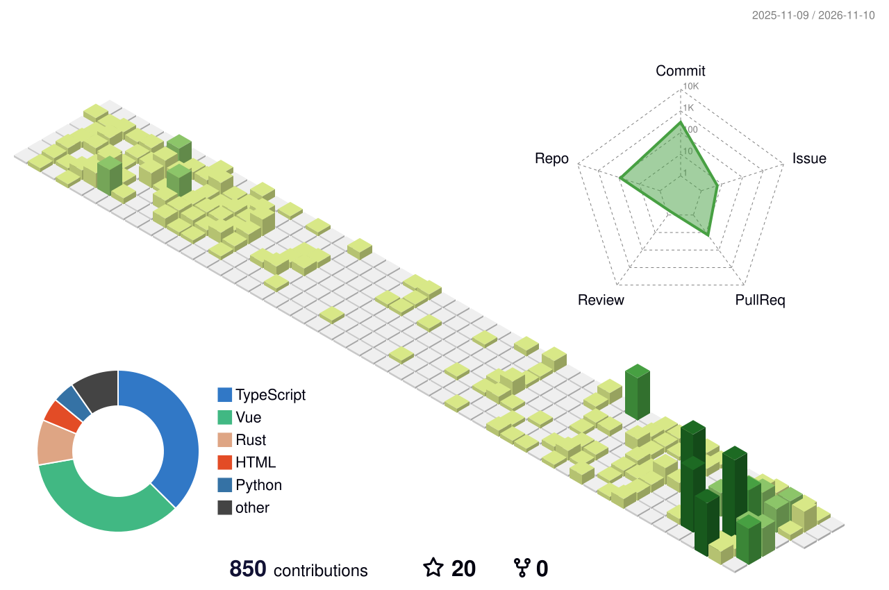

  

<h1 align="center">您好 👋✨ </h1>

- 🔭 Backend engineer working with PHP / Laravel, Node.js, Go and Rust
- 🦀 Building [sunny-lang](https://github.com/AdaaWu/sunny-lang), my own programming language in Rust
- 🌱 Contributing to [g0v/civic-talk-hono](https://github.com/g0v/civic-talk-hono), using AI to lower the barrier to public deliberation
- 🎮 Side projects: a sea-slug card battle game (🚧 WIP, Vue 3 + three.js) and Rust Quest (Vue 3 + Axum)
- 💬 Ask me about clean code, backend architecture, fitness or parenting
- 📫 Reach me by opening an issue on this repo
- 😄 Pronouns: She/Her
- ⚡ Fun fact: I love spending time with my family!

## 😃 My Maxims

> I maintain both physical activity and meditation.
>
> 
>
> I love coding ❤️
>
> 

<h2 align="center">💻 My Tech Stack</h2>

<h3 align="center">🎨 Frontend</h3>

<h3 align="center">⚙️ Backend</h3>

<h3 align="center">🗄️ Database</h3>

<h3 align="center">🚀 DevOps & Cloud</h3>

<h2 align="center">🎤 Talks</h2>

- **JSDC 2025**（2025/11/29）〈JS 程式碼改造計畫：從揪出異味到實現 Clean Code〉｜[簡報 PDF](https://github.com/AdaaWu/sunny-jsdc-20251129/blob/main/JSDC%20-%20JS%20%E7%A8%8B%E5%BC%8F%E7%A2%BC%E6%94%B9%E9%80%A0%E8%A8%88%E7%95%AB%EF%BC%9A%E5%BE%9E%E6%8F%AA%E5%87%BA%E7%95%B0%E5%91%B3%E5%88%B0%E5%AF%A6%E7%8F%BE%20Clean%20Code%20-%20SunnyWu.pdf)
- **DevOpsDay Taipei 2026** Workshop〈Go 整合 ECS Service Connect 與 LLM 實作 AIOps 自動化決策〉｜[Workshop repo](https://github.com/AdaaWu/devOpsDay-Taipei-2026-ecs-workshop)

<h2 align="center">🌍 Open Source</h2>

- [g0v/civic-talk-hono](https://github.com/g0v/civic-talk-hono)
  - [#197 fix: 意見分頁與其他分頁版面一致](https://github.com/g0v/civic-talk-hono/pull/197)
  - [#193 feat: 說明卡新增一鍵複製 Markdown 按鈕](https://github.com/g0v/civic-talk-hono/pull/193)
  - [#192 fix: 說明輪播停用滑鼠拖曳以便選取文字](https://github.com/g0v/civic-talk-hono/pull/192)
- [LibreSign/libresign](https://github.com/LibreSign/libresign)
  - [#9214 refactor(id-docs): use typed exceptions for id-doc resolution errors](https://github.com/LibreSign/libresign/pull/9214)

<!-- 

  

 -->

